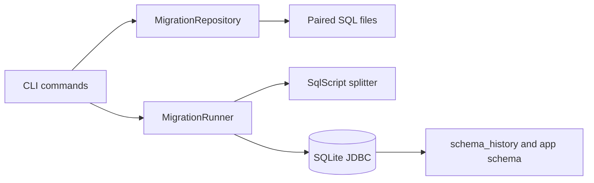

# Schema Guard — Database Design and Migration Toolkit

Schema Guard is a Java CLI for managing small SQLite schemas with paired, versioned SQL migrations. It validates migration names and pairs, applies changes transactionally, records SHA-256 checksums, detects edited or missing applied migrations, reports pending work, and rolls back one migration at a time.

## Features

- Strict `V0001__description.up.sql` / `.down.sql` pairs with contiguous versions.
- SQLite `schema_history` table with timestamps and immutable-up checksum tracking, plus a schema fingerprint that detects out-of-band DDL.
- Transactional apply and rollback, foreign-key enforcement and bounded SQLite busy timeout.
- Status, dry-run plan, validation, forward migration and one-step rollback commands.
- SQL splitting that respects common quote styles and SQL comments.
- JUnit tests for idempotent apply, rollback, checksum drift, malformed pairs, SQL splitting and failed-transaction recovery.

## Requirements and setup

- JDK 21 and Gradle 8.14.3 or newer.
- SQLite is embedded through the pinned Xerial JDBC driver; no external database server is required.

From this directory:

```sh
gradle test
gradle run --args=validate
gradle run --args=status
gradle run --args=plan
gradle run --args=up
gradle run --args=rollback
```

The Gradle build downloads declared dependencies from Maven Central. The Termux environment used for this implementation has less free disk space than the JDK install requires; Java compilation and JUnit execution have not run locally. CI runs tests and migration-file validation on JDK 21.

## Configuration

Copy the values in `.env.example` into the shell environment or set them directly. `SCHEMA_GUARD_JDBC_URL` defaults to `jdbc:sqlite:./data/schema-guard.db`; `SCHEMA_GUARD_MIGRATIONS` defaults to `./migrations`. `validate` checks files without connecting to a database. SQLite is the only supported driver in this MVP.

## Migration format

Each version must have an up/down pair:

```text
migrations/
  V0001__create_projects.up.sql
  V0001__create_projects.down.sql
  V0002__add_project_status.up.sql
  V0002__add_project_status.down.sql
```

Versions start at 1 and cannot have gaps. Once applied, an `up.sql` file is immutable; create a new migration to change the schema. A migration’s statements, history row and resulting schema fingerprint commit together. `plan` does not execute application migrations; its first run creates the internal history and fingerprint tables. It displays pending forward migrations and the latest rollback candidate. `rollback` runs the matching down script and removes only the latest history entry. Back up data before applying or rolling back schema changes.

## Architecture



## Safety boundaries and limitations

This MVP is for local projects and controlled environments. Review backups, locking behavior, recovery procedures and migration SQL before using it on production data. Migration files are executable SQL and must come from a trusted source. Schema drift detection fingerprints `sqlite_master`; it detects table, index, view and trigger definition changes, not row-level changes or every database file corruption. SQL triggers and procedural SQL with semicolons inside compound statements are not supported by the script splitter. Checksums cover the exact UTF-8 bytes of each `up.sql` file. Authors must supply and review a compensating `down.sql`; rollback does not restore deleted data.

The project uses the repository MIT license. Contributions should add paired migrations and tests for success, failure rollback and drift handling; do not add credentials or real-data fixtures.
