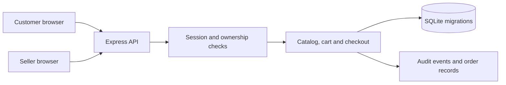

# Market Square — Full-Stack E-commerce Marketplace

Market Square is a local-first marketplace web app built with a TypeScript browser client, a TypeScript/Express API and SQLite. Customers can register, browse products, maintain a cart and place idempotent orders. Seller accounts manage one store, its products and store-scoped order lines.

## Problem and scope

Small teams need a clear example of marketplace workflows where inventory, identity and order ownership matter. Market Square implements catalog, seller boundaries and atomic inventory checkout. It intentionally does not process payments, collect card data, calculate tax or shipping, or make a production commerce compliance claim.

## Features

- Account registration, scrypt password hashes, opaque hashed server-side sessions, secure cookie options and logout.
- Responsive same-origin storefront for account registration/sign-in, product browsing, cart updates, demo checkout and seller product management.
- Seller store ownership enforced on product and order routes; customers can only read their own carts and orders.
- Bounded product listing, validated integer-cent prices, inventory constraints and archived product handling.
- Cart quantities are validated but do not reserve stock. Checkout rechecks inventory in an immediate SQLite transaction.
- Idempotency keys make checkout retries return the same order without decrementing stock again.
- Orders explicitly use `SIMULATED_UNPAID`; no payment-provider integration or charge is implied.
- Structured request/error logs, SQL migrations, integration tests, Docker image and loopback-only Compose demo.

## Architecture

`client/app.ts` drives the browser UI through same-origin JSON routes. `src/app.ts` defines HTTP routes and serves the compiled client, `src/auth.ts` enforces session and store ownership, `src/security.ts` owns password/session primitives, and `src/database.ts` opens SQLite and applies ordered migrations. SQLite constraints remain the final guard for uniqueness, price, stock and foreign-key invariants.



## Requirements and local setup

- Node.js 24.15 or newer (uses the built-in `node:sqlite` API).
- npm 10 or newer.

```sh
cp .env.example .env
npm ci
npm run typecheck
npm test
npm run migrate
npm start
```

The service binds to `127.0.0.1:3001` by default. It creates the database parent directory with owner-only permissions, enables foreign keys, WAL and a bounded SQLite busy wait. Open [http://127.0.0.1:3001](http://127.0.0.1:3001) to use the storefront. Create a customer account, open a seller store, publish a product, then sign in as a second synthetic customer to exercise cart and checkout. No default credentials are included.

Check service health and view products:

```sh
curl http://127.0.0.1:3001/health
curl 'http://127.0.0.1:3001/products?limit=30&offset=0'
```

For a full account, seller, product, cart and checkout sequence, follow [API.md](API.md). Set `SECURE_COOKIES=true` behind HTTPS. Do not expose the development server directly to the public internet.

## Docker demonstration

With Docker Compose installed:

```sh
docker compose up --build
curl http://127.0.0.1:3001/health
```

Compose binds only to loopback, uses a named SQLite data volume, a read-only container root, dropped capabilities and a bounded memory/CPU/process profile. This demo keeps secure cookies disabled for local HTTP; production requires a TLS reverse proxy and `SECURE_COOKIES=true`.

## Data model and tests

`migrations/001_initial.sql` creates users, hashed sessions, stores, products, cart items, orders, order lines and audit events. Prices use integer cents. The API integration suite uses a temporary in-memory database and an ephemeral loopback server; it covers repeat migrations, validation, unauthorized seller access, bounded listings, concurrent stock contention, order idempotency, inventory decrement and serving compiled storefront assets with a strict content security policy.

GitHub Actions runs server and client type-checking, integration tests, high-severity dependency audit and a production Docker build. In the Codex Termux shell, unset the injected `LD_LIBRARY_PATH` when invoking Node/npm if Node reports a missing `__hash_memory` symbol: `env -u LD_LIBRARY_PATH npm test`. This workaround selects Termux's system C++ runtime; it does not change the project runtime or dependencies.

## Security boundaries and limitations

- Do not commit `.env`, SQLite databases, session tokens, or customer data.
- Passwords are never stored in clear text; session tokens are random and only their SHA-256 digests are persisted.
- Route access is bound to the authenticated user or seller store owner. SQL values use prepared statements and request schemas reject unknown fields.
- Cookie settings use `HttpOnly` and `SameSite=Strict`. Configure `Secure` under HTTPS; the browser UI and API are same-origin and the app does not enable cross-origin requests.
- This learning project has no production payment, tax, shipping, refund, fulfillment, account recovery, MFA, login rate limiting, external rate-limit store, or multi-region database support. These boundaries need review before any deployment.

## Contribution and license

Follow the repository contribution guide. Changes to checkout must include stock contention, duplicate retry and rollback tests. This project uses the repository MIT license.
