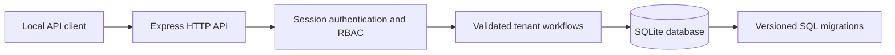

# Enterprise SaaS Management Platform

A local-first TypeScript and SQL API for managing organizations, users, tenant roles, subscription records and auditable administrative changes. It solves the common SaaS control-plane problem of keeping organization data isolated while central administrators manage customer accounts.

**Milestone:** MVP verified locally on Node.js 24.22.1. Type-check, build, unit tests, HTTP integration tests, dependency audit and file-backed migrations passed. A loopback health/login/session walkthrough passed. No live hosting or payment processing is provided.

## Features

- Tenant and user records in SQLite with versioned SQL migrations and foreign-key constraints.
- Bootstrap platform administrator configured explicitly through environment variables.
- Scrypt password hashes with random per-password salts; no plaintext password storage.
- Cryptographically random opaque sessions, server-side expiry/revocation and hashed session tokens.
- Platform administrator and tenant-specific `OWNER`, `ADMIN`, `BILLING`, `MEMBER`, and `VIEWER` roles.
- Least-privilege tenant access and guarded membership, subscription and audit operations.
- New tenant, owner membership, trial subscription and audit event committed as one transaction.
- Request schemas, bounded JSON bodies, generic credential errors, security headers and structured request/error logs without secrets.
- Unit and HTTP integration tests, lockfile-based dependency installation, GitHub Actions checks.

## Architecture



The API is a single Node process and opens the configured SQLite database. Passwords use Node's built-in `scrypt`; sessions use random bearer values in an HttpOnly cookie while only their SHA-256 digests are persisted. SQL constraints provide a second validation layer. See [API.md](API.md) for routes and payloads.

## Requirements

- Node.js 24.15 or newer and npm (the built-in `node:sqlite` API is a release candidate in Node 24).
- No Python runtime is used by this project.

## Local installation

```sh
cd enterprise-saas-management
env -u LD_LIBRARY_PATH npm ci
cp .env.example .env
```

Edit `.env` and replace `BOOTSTRAP_PASSWORD` with a unique random password of at least 12 characters. `.env` is ignored by Git. For a shell-only setup, export the same settings instead of creating `.env`:

On Termux shells where `LD_LIBRARY_PATH` points to an unrelated bundled runtime and Node reports a missing shared-library symbol, run npm commands with `env -u LD_LIBRARY_PATH npm ...` so Node uses Termux's own libraries.

```sh
export DATABASE_PATH=./data/saas.sqlite
export BOOTSTRAP_EMAIL=admin@example.test
export BOOTSTRAP_PASSWORD='replace-with-a-unique-random-password'
export COOKIE_SECURE=false
env -u LD_LIBRARY_PATH npm run migrate
env -u LD_LIBRARY_PATH npm run dev
```

The server binds to `127.0.0.1` and uses port `3000` by default. `COOKIE_SECURE=false` is suitable only for loopback HTTP development. Set it to `true` behind HTTPS. If no bootstrap credentials are set, the service starts without an administrator and cannot create users or tenants until an account is provisioned out of band. The email and password must be configured together.

On standard Node installations, the `env -u LD_LIBRARY_PATH` prefix can be omitted. It avoids a shared-library mismatch in Termux shells that inject an unrelated `LD_LIBRARY_PATH`.

Check readiness:

```sh
curl http://127.0.0.1:3000/health
# {"status":"ok"}
```

## Demonstration workflow

Use the bootstrap admin to create a tenant, create a second user, and attach that account with a role. Passwords are sent only in the local request body and are never returned:

```sh
curl -sS -c data/saas-cookies.txt -H 'Content-Type: application/json' \
  -d '{"email":"admin@example.test","password":"YOUR_BOOTSTRAP_PASSWORD"}' \
  http://127.0.0.1:3000/auth/login

curl -sS -b data/saas-cookies.txt -H 'Content-Type: application/json' \
  -d '{"name":"Example Organization","slug":"example-organization"}' \
  http://127.0.0.1:3000/tenants

curl -sS -b data/saas-cookies.txt -H 'Content-Type: application/json' \
  -d '{"email":"billing@example.test","password":"a-different-long-random-password"}' \
  http://127.0.0.1:3000/users
```

Use returned IDs in `POST /tenants/:tenantId/members`, then verify billing access with `GET` and `PUT /tenants/:tenantId/subscription`. Tenant members cannot enumerate unrelated organizations; viewer/member roles cannot modify billing or read the admin audit endpoint. See [API.md](API.md) for exact requests. For an HTTP transcript suitable as a demo capture, run the sequence above and save the terminal output; no screenshot is claimed until one is captured from a running service.

## Configuration

| Variable | Default | Purpose |
|---|---|---|
| `PORT` | `3000` | Local HTTP port |
| `DATABASE_PATH` | `./data/saas.sqlite` | SQLite database file |
| `SESSION_TTL_HOURS` | `12` | Session lifetime, bounded from 1 to 168 hours |
| `COOKIE_SECURE` | `false` | Mark cookie Secure when serving HTTPS |
| `BOOTSTRAP_EMAIL` | unset | Initial platform administrator email |
| `BOOTSTRAP_PASSWORD` | unset | Initial administrator password, minimum 12 characters |

## Database and migrations

Migration `migrations/001_initial.sql` creates users, tenants, memberships, subscriptions, opaque sessions and audit events. Foreign keys and role/status/seat constraints are enabled. `npm run migrate` is safe to rerun; schema versions are recorded with SQLite `user_version`. Back up the database file while the service is stopped for this MVP.

## Testing and quality checks

```sh
env -u LD_LIBRARY_PATH npm test
env -u LD_LIBRARY_PATH npm run typecheck
env -u LD_LIBRARY_PATH npm run build
env -u LD_LIBRARY_PATH npm audit --audit-level=high
```

Unit tests cover password/session helpers and configuration validation. HTTP integration tests exercise authentication, bad credentials, tenant provisioning, role isolation, billing authorization, validation and logout revocation. GitHub Actions runs the same test/type/build checks and an npm dependency audit on Node.js 24.

## Security boundaries and limitations

- This is a local single-process MVP. Local SQLite and cookie sessions need review before multi-instance or public deployment.
- SQLite currently uses Node's built-in `node:sqlite` API, which Node classifies as a release candidate; pin Node 24 and include database migration/backup compatibility checks when upgrading the runtime.
- There is no account recovery, email verification, invitation delivery, SSO, MFA, automated cleanup worker or production secret manager yet.
- Browser clients should use the strict same-site session cookie and JSON requests. Cross-origin browser access is not enabled.
- Subscription changes are administrative records only; there is no payment gateway or claim of payment processing.
- Platform-admin user creation is the only account provisioning path; it currently accepts a password directly and should gain a one-time invitation flow before public use.
- Audit rows are application-level history, not tamper-proof forensic evidence. The last 100 events are exposed per tenant.
- Rate limiting, operational metrics, backup/restore automation and production deployment hardening are future milestones.
- Docker is omitted in this milestone because the intended initial environment is a local Termux/Node development setup; a container profile can be added in a later deployment milestone.

## Future milestones

1. Add invitation/reset flows, persistent login throttling, CSRF/origin policy and security review.
2. Add backup/restore drills, operational metrics, migration recovery guidance and a supported container deployment.
3. Capture a reproducible local demo and update the portfolio index with verified evidence.

## License and contributions

This project inherits the repository's [MIT License](../LICENSE). Follow [repository contribution guidance](../CONTRIBUTING.md); include tests and update this README when behavior or operational requirements change.
