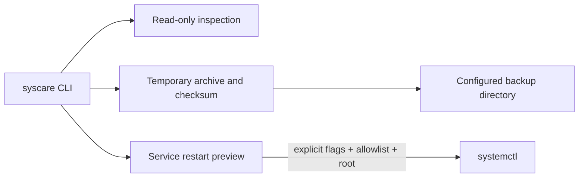

# SysCare — Linux System Administration Toolkit

SysCare is a Bash toolkit for read-only host diagnostics, directory inspection, verified file backups and explicitly guarded systemd service restarts. The default diagnostic and service-restart commands do not change the host.

## Problem and features

Operators need small, scriptable checks that report what they observed and make any system change explicit. SysCare emits JSON Lines for diagnostics and actions so output can be collected without parsing free-form terminal text.

- `diagnose` reports free space for a selected filesystem and available memory when `/proc/meminfo` exists.
- `inspect` counts regular files and measures a directory without following symlinks or crossing filesystem boundaries.
- `backup` archives a user-selected directory beneath a configured backup root, rejects special files and backup destinations inside the source, validates the gzip/tar, writes a SHA-256 manifest, and restricts generated file permissions to the invoking user.
- `service-check` reads one validated systemd unit's state when `systemctl` is present.
- `service-restart` prints a preview by default. Applying it requires both `--apply --confirm`, root privileges, a unit in `SYSCARE_ALLOWED_SERVICES`, and an available systemd host. It never invokes `sudo`.
- Shell tests use only synthetic temporary fixtures and remove only their own temporary directory.

## Architecture and boundaries

`bin/syscare` contains the CLI, validation, structured output, diagnostics, backup and guarded service operations. `tests/run.sh` exercises the command against temporary fixture files. No third-party runtime dependencies are required; ShellCheck and jq are used by CI.



Backups are not encrypted and may include sensitive files selected by the operator. Store them on an appropriately protected or encrypted volume. This toolkit has no restore command, remote management, alerting service, package manager automation or automatic repair policy. `systemctl` operations are unavailable on Termux and other non-systemd hosts; diagnostics and backups remain useful there.

## Requirements and setup

- Bash 4.4 or newer.
- GNU-compatible `df`, `find`, `du`, `tar`, `gzip`, `sha256sum` and `stat` tools from the host environment.
- `systemctl` only for service inspection/restart.
- `jq` and ShellCheck for the test/lint workflow.

There are no downloaded dependencies or build step. Review `.env.example` for the supported environment variables; it is a reference file and is not executed by the tool.

```sh
bash -n bin/syscare tests/run.sh
bash tests/run.sh
shellcheck bin/syscare tests/run.sh
```

## Examples

Read-only filesystem and memory checks:

```sh
bash bin/syscare diagnose /
bash bin/syscare inspect ./fixtures
```

Create and verify a local backup:

```sh
SYSCARE_BACKUP_DIR="$HOME/syscare-backups" bash bin/syscare backup ./fixtures
cd "$HOME/syscare-backups"
sha256sum -c ./*.sha256
```

Preview a service operation before deciding whether to apply it:

```sh
bash bin/syscare service-check ssh.service
bash bin/syscare service-restart ssh.service
```

The restart command above only prints a JSON preview. An operator can separately authorize a specific allowlisted restart as root:

```sh
SYSCARE_ALLOWED_SERVICES=ssh.service bash bin/syscare service-restart ssh.service --apply --confirm
```

Example diagnostic output:

```json
{"event":"system_check","check":"filesystem","status":"ok","detail":"123456 KiB available"}
{"event":"system_check","check":"memory","status":"ok","detail":"987654321 bytes available"}
```

## Tests, CI and security

The fixture suite validates JSON output, file counts, archive contents, symlink preservation, archive checksums and file mode, rejection of nested backup destinations and special files, restart previews, and rejection of option-like unit names. GitHub Actions runs `bash -n`, ShellCheck and the fixture suite. It does not restart any host service.

Never point backups at data you are not authorized to copy. Do not use an unreviewed backup as a restore source. The tool intentionally leaves recovery and restore decisions to an operator.

## Contribution and license

Follow the repository contribution guidance. Any new mutating operation needs a dry-run mode, explicit scope checks and synthetic tests. This project uses the repository MIT license.
