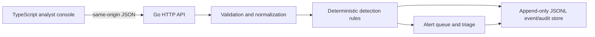

# Signal Desk — Mini SIEM Cybersecurity Platform

Signal Desk is a defensive, local-first event ingestion and alert triage MVP. It accepts normalized synthetic/authentication events, evaluates two explicit detection rules, stores append-only JSONL audit records and presents a TypeScript analyst console. It is intended for authorized defensive training and local operations demonstrations.

## Problem and features

Small lab environments need an understandable event-to-alert workflow before adopting a full SIEM. This MVP includes:

- Validated event ingestion with bounded JSON payloads, timestamps, IP addresses and normalized fields.
- A five-failed-logins-in-five-minutes rule and a privilege-change rule.
- Durable event and alert records plus append-only analyst triage history.
- Bearer-token authentication, alert acknowledgement/resolution and recent-event review.
- A TypeScript dashboard using safe text rendering, same-origin requests and an in-memory token.
- Structured JSON request logs, security headers, graceful shutdown and a non-root Docker image.

## Architecture



Go packages divide API handling, event model/normalization, detection rules and durable storage. The store is a single-process file-backed journal protected by an in-process mutex. Each event and its generated alerts are written as one JSONL record before in-memory state changes.

## Requirements and local setup

- Go 1.22 or newer
- Node.js 24 and npm (TypeScript is pinned in `package-lock.json`)
- `curl` for API examples
- Docker is optional

```sh
npm ci
npm run typecheck
npm run build
go test -race ./...
go vet ./...
go build -o siem ./cmd/siem
```

Configure the local token and start the server:

```sh
export SIEM_API_TOKEN="$(openssl rand -hex 32)"
export SIEM_BIND="127.0.0.1:8090"
export SIEM_DATA_FILE="./data/events.jsonl"
go run ./cmd/siem
```

Open <http://127.0.0.1:8090>. The API is disabled until `SIEM_API_TOKEN` is set. The default bind address is loopback. Any non-loopback bind requires a token of at least 32 characters. Never commit `.env` files, credentials, or real personal data.

## Demonstration

Connect with the configured token and use the dashboard's synthetic-event form. To exercise the threshold rule, submit five `Failed login` events with the same actor and failure outcome in a five-minute window. The resulting high-severity alert appears in the queue; acknowledge or resolve it and refresh to verify the stored state.

Alternatively:

```sh
curl -sS http://127.0.0.1:8090/api/v1/health
curl -sS -H "Authorization: Bearer $SIEM_API_TOKEN" \
  -H 'Content-Type: application/json' \
  -d '{"occurred_at":"2026-10-24T12:00:00Z","source":"auth-demo","actor":"synthetic-user","action":"failed_login","outcome":"failure","source_ip":"192.0.2.10"}' \
  http://127.0.0.1:8090/api/v1/events
```

See [API.md](API.md) for schemas, limits, rules and status codes. No screenshot is claimed; the local UI/API workflow is the reproducible demonstration.

## Tests and quality gates

Go tests cover normalization boundaries, deterministic detection thresholds, JSONL restart/recovery, durable triage, auth, HTTP ingestion and malformed/oversized request rejection. Go tests, `go vet ./...`, and a local binary build passed on Go 1.27.3/Android ARM64. TypeScript strict type checking, build, JavaScript syntax check and offline npm audit also passed (zero advisories). A loopback smoke test served health/dashboard assets, created the expected alert after five synthetic failures, and persisted acknowledgement. CI additionally runs race-enabled tests and builds the Docker image; Docker itself was not available for a local build.

## Security model and limitations

- Ingestion, event reads, alert reads and triage require a constant-time-checked bearer token. Health returns only liveness.
- Default listener is loopback; public listeners need a long configured token. Docker also requires a token because it binds inside the container to `0.0.0.0`.
- Request bodies and strings have bounds; unknown JSON fields, invalid event timestamps/outcomes/IPs and duplicate IDs are rejected. Errors do not disclose filesystem paths.
- Data uses mode `0600` and parent directories mode `0700` where created. The JSONL file is local audit storage, not encrypted. Protect the host volume and backups.
- This MVP has no multi-user roles, rate limiting, retention/rotation, external log collectors, alert deduplication across distributed writers, threat-intel enrichment or production durability guarantees. Run one process against one local volume.
- Use fabricated or sanitized data only. No offensive scanning or exploitation capability is included.

## Docker

```sh
docker build -t signal-desk .
docker run --rm -p 127.0.0.1:8090:8090 \
  -e SIEM_API_TOKEN="$(openssl rand -hex 32)" \
  -v signal-desk-data:/var/lib/siem signal-desk
```

## Contribution and license

Add synthetic fixtures for new detections, document false-positive trade-offs and run all CI checks. Keep field validation and payload limits at the ingestion boundary. This project uses the repository-level MIT license; see [LICENSE](../LICENSE).
