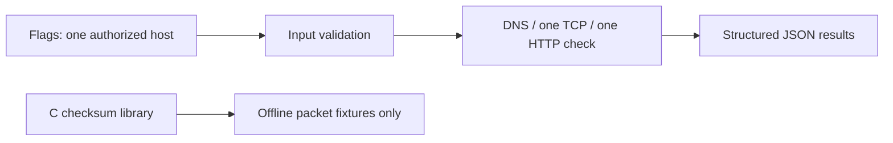

# Network Monitoring and Diagnostics Suite

A bounded diagnostic CLI for a **single explicitly authorized host**. It checks DNS and optionally one TCP port and one HTTP(S) endpoint, producing JSON for operations dashboards. A separate C library computes Internet checksums for offline packet fixtures and performs no network I/O.

## Problem and features

Operators need repeatable endpoint checks without an unbounded scanner. This MVP provides hostname/IP validation, DNS lookup, one bounded TCP connection, optional HTTP(S) GET constrained to the target hostname, redirect refusal, timeouts and machine-readable output. It does not scan port ranges or discover hosts.

## Architecture

Go CLI → standard-library resolver/dialer/HTTP client → JSON result records. Native C contains an offline checksum helper, separately testable from Go and not called by network probes. Host and port selection are explicit; HTTP redirects are not followed.



## Requirements and setup

- Go 1.22 or newer
- C11 compiler with AddressSanitizer/UBSan for native tests (GCC or Clang)
- `make` (optional)

Run `go test ./...`, then `go build -o network-monitor .`.

```sh
go run . -target localhost -tcp 22 -timeout 2s
go run . -target example.org -http https://example.org/health
```

Only probe systems you own or are authorized to assess. Results depend on DNS, firewall policy and endpoint availability. HTTP endpoint host must exactly match the target hostname; redirects are not followed.

## Example output

```json
[
  {"target":"localhost","check":"dns","ok":true,"duration_ms":0},
  {"target":"localhost","check":"tcp","ok":false,"duration_ms":1,"error":"connection refused"}
]
```

See [API.md](API.md) for flags, exit behavior and JSON fields.

## Tests

`go test ./...` exercises validation and local TCP/HTTP fixtures without external network dependencies. `go vet ./...`, `go run . -target 127.0.0.1 -timeout 1s`, and `make test-c` (strict C11 warnings with AddressSanitizer/UBSan) passed locally on Go 1.27.3/Android ARM64 and Termux Clang. No Go modules beyond the standard library are used. The CI race-enabled test and non-Android builds remain runner checks.

## Security and limitations

No credentials are stored. Requests use bounded timeouts and GET only; response bodies are closed unread. There is no raw-socket ping, subnet enumeration or remote scanning. DNS behavior depends on the system resolver. This is an educational/operations MVP, not an SLA monitor. The JSON CLI run is the reproducible demo; no screenshot is claimed.

## Contribution

Keep probes bounded to a single authorized target, add fixture-based tests, validate destinations and avoid logging secrets. See the repository contribution guidance.
