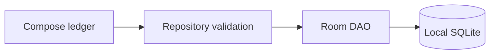

# Pocket Ledger — Personal Finance and Budgeting Android App

Offline-first ledger for recording income/expenses and maintaining monthly category budgets. MVP stores data on-device with Room/SQLite and has no network permission or analytics SDK.

## Problem and features

Spreadsheets are awkward on the go. Pocket Ledger provides a local ledger with income/expense entry, exact minor-unit money parsing, currency-separated balances, monthly category budgets and spending progress, weekly/monthly recurring rules with idempotent catch-up, monthly totals and CSV export through Android's document picker. Charts, account synchronization and receipt capture are future work.

## Architecture

Compose UI → `LedgerRepository` validation/use cases → Room DAO and transactions → SQLite. Amounts use integer minor units to avoid floating-point arithmetic. Dates use ISO-8601 calendar days. A Room 1→2 migration adds recurring rules and idempotency receipts and rebuilds budget keys to include currency. Destructive fallback is disabled.

## Requirements and setup

- Android Studio Ladybug or newer, JDK 17, Android SDK 35, Gradle 8.9+
- Open this directory in Android Studio and sync Gradle, or run `gradle testDebugUnitTest assembleDebug`.
- Run on an API 26+ emulator/device. The UI records income/expenses, budgets and recurring rules in USD, shows monthly totals, and exports CSV using the system document picker.

Dependency versions are pinned in the Gradle Kotlin DSL. No generated wrapper JAR or signing key is committed. Create a wrapper with `gradle wrapper --gradle-version 8.9` using a trusted Gradle install.

## Tests

`gradle testDebugUnitTest` covers amount and recurrence boundaries plus CSV escaping. `gradle connectedDebugAndroidTest` tests legacy schema migration, budget preservation, recurring idempotency, reports and CSV against Room/SQLite on an emulator. CI runs both tasks. `node --test tooling/migration-contract.test.mjs` executes the SQL statements extracted from the Room migration against SQLite and checks budget preservation, composite currency keys and recurrence foreign keys. On 2026-10-25, GitHub Actions passed this migration contract, JVM unit tests and the debug APK build. The emulator instrumentation job timed out before Android API 35 booted on Ubuntu 24.04. The workflow now pins instrumentation to Ubuntu 22.04; GitHub did not start the retry because the account's Actions billing/spending limit blocks runners. This Termux environment lacks Gradle, Kotlin/JDK and Android SDK, so local Android build and instrumentation checks remain unavailable.

## Security and limitations

All records are synthetic/local. No account credentials are collected; Android sandbox is the storage boundary and app backup is disabled. There is no encryption-at-rest claim. Never enter bank credentials. This is not financial advice or a bank integration.

## Demo

Enter `12.50` and category `Groceries`, then tap **Add expense**. The amount is stored as 1250 minor units. Invalid and overflowing input is rejected.

## Project status and contribution

MVP source, local persistence, budgets, recurrence, reporting and CSV export are implemented. GitHub Actions verified JVM unit tests and the debug build; Room/emulator instrumentation remains unverified until the Actions billing/spending restriction is resolved and the updated Ubuntu 22.04 workflow can run. Keep money in integer minor units, add forward migrations and migration tests for schema changes, and use synthetic data. See the repository contribution guide.
