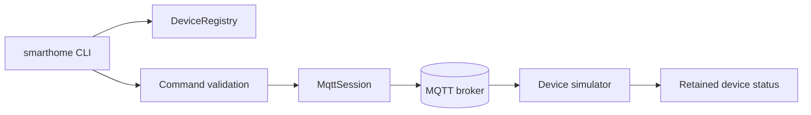

# Hearthline — IoT Smart Home Control System

Hearthline is a C++ command-line controller and MQTT device simulator for a small smart-home network. It keeps a reviewed device registry, validates commands by device type and publishes versioned desired-state messages. A simulator subscribes to those messages and publishes retained device status, giving the project a reproducible broker-backed demonstration without real hardware.

## Features

- Device registry validation with unique, constrained identifiers and allow-listed device kinds.
- MQTT QoS 1 command and status topics under `portfolio/smarthome/v1/devices/<id>/`.
- Retained desired-state messages for reconnecting devices; simulator commands are idempotent.
- Per-device command validation: on/off, light level from 0–100, thermostat target from 5–35 °C.
- MQTT username/password support; remote brokers require `ssl://`, a configured CA trust bundle and certificate verification.
- Anonymous MQTT is disabled by default and can be explicitly enabled only for loopback development.
- C++ core tests plus a Mosquitto broker integration smoke test.

This is a controlled demonstration. It does not connect to real consumer devices, perform automatic firmware updates, provide user accounts, or implement a production broker ACL. Configure broker authorization so a device can publish only its own status and subscribe only to its own command topic. Retained status can become stale after a device disappears; an MQTT last-will/heartbeat availability protocol is future work.

## Requirements

- C++20 compiler and CMake 3.20+.
- Eclipse Paho MQTT C++ 1.6.0 with TLS support.
- Mosquitto 2.x broker and clients for the full integration test.

On Ubuntu, install a TLS-enabled Paho MQTT C/C++ build and Mosquitto. The CI workflow builds Paho from the official `v1.6.0` release with its C submodule, then installs Mosquitto from Ubuntu packages.

## Build and test

```sh
cmake -S . -B build -DCMAKE_BUILD_TYPE=Release
cmake --build build --parallel
ctest --test-dir build --output-on-failure
sh tests/mqtt-smoke.sh ./build/smarthome
```

The core suite validates registry boundaries, device/action compatibility, numeric limits, MQTT payload parsing and canonical topic names. The broker smoke starts a local broker, runs a simulated lamp, publishes a command and checks the retained status response. The Termux environment has a working C++ compiler; the dependency-free core tests passed locally. Paho and Mosquitto are not installed here, so the complete MQTT executable and broker integration have not run locally.

## Configuration and demo

Copy `.env.example` values into the shell environment. `SMART_HOME_DEVICES` defaults to `./config/devices.csv`; broker host, port and TLS selection are represented by `SMART_HOME_MQTT_URI`, which defaults to `tcp://127.0.0.1:1883`. Set `SMART_HOME_MQTT_USERNAME` and `SMART_HOME_MQTT_PASSWORD` for authenticated brokers. Remote TLS also requires `SMART_HOME_MQTT_CA_FILE` pointing to the PEM trust bundle. Set `SMART_HOME_ALLOW_ANONYMOUS_LOCAL=1` only with a loopback broker during local development.

With a local Mosquitto broker running:

```sh
export SMART_HOME_ALLOW_ANONYMOUS_LOCAL=1
./build/smarthome list
./build/smarthome simulate demo-lamp
```

In a second shell, publish a command or monitor retained status:

```sh
export SMART_HOME_ALLOW_ANONYMOUS_LOCAL=1
./build/smarthome publish demo-lamp level 45
./build/smarthome monitor 10
```

Use `publish demo-thermostat target 21` to set a thermostat fixture. Registry IDs and room names are deliberately limited to letters, digits, underscore and hyphen; the CSV format does not accept quoted fields.

## Message model

Commands are JSON on `portfolio/smarthome/v1/devices/<id>/command`, for example `{"command":"set_level","value":45}`. Status is JSON on the matching `/status` topic. Commands are retained and use QoS 1; consumers must keep operations idempotent because QoS 1 can redeliver. Credentials are read from the environment and never printed. The broker remains responsible for account lifecycle, topic ACLs, certificate management and audit retention.

## Architecture



## License and contributions

This project uses the repository MIT license. Contributions should add validation and broker-backed tests for new device types or command fields. Never add real device credentials, broker passwords, private keys or personal household data.
